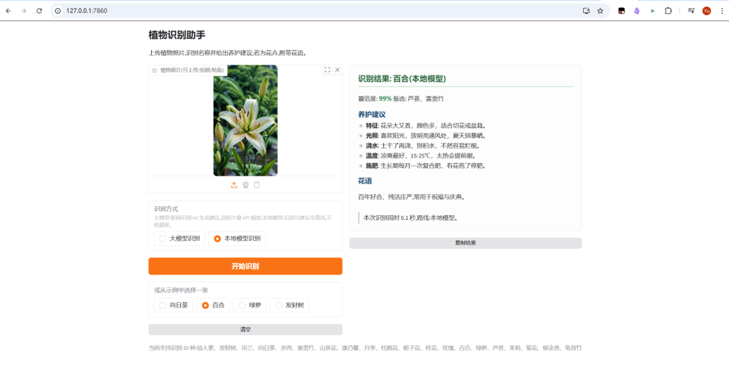

# 植物识别 AI Agent —— 代码说明

基于 DeepSeek 多模态大模型 + 本地 MobileNet 的植物识别智能体:上传植物照片,输出植物名称(含置信度与 Top-3 候选)与养护建议;若为花卉,附带花语。

## 界面预览



## 一、目录结构

```
code/
├── config.py           配置(API Key、模型名、CV 路径)
├── llm.py              大模型客户端(懒加载)
├── vision/             识图:api(大模型)/ local(本地 CV)
├── advice/             养护建议:检索 + LLM / 离线原文
├── tools.py            兼容转发壳(compare.py 仍从此导入)
├── agent.py            编排:识别 → 检索 → 生成,拼装输出
├── app.py              Gradio 网页界面(照片 + 问答框)
├── retrieval/          检索子系统
│   ├── settings.py     检索配置(模型、缓存、知识库、超参)
│   ├── rag.py          检索入口(分块、路由、回退)
│   ├── retrievers.py   BM25 / 稠密向量(Qwen3-Embedding)/ RRF 融合
│   ├── router.py       查询特征路由 + 检索质量回退(CRAG-lite)
│   └── eval.py         5 组检索对照评测(零 API)
├── train.py            本地模型训练(支持 --mode full|reg|frozen)
├── compare.py          双路线对比评测(输出 指标/对比表.md)
├── download_images.py  数据集采集脚本(按关键词批量下载并清洗图片)
├── scripts/build_eval.py  评测题候选生成(需人工改写)
├── tests/              单元测试(chunk 解析、RRF、路由、兼容性)
├── kb/                 植物养护知识库(文本,按植物 + 小节分块)
├── models/             训练权重、类别表;cache/ 为可重建的 chunks/向量缓存
├── data/               训练集;eval/ 为评测集(eval_queries.jsonl)
├── docs/               开发契约(dev/)与论文材料(thesis/)
└── 指标/               CV 产物;retrieval/ 为检索评测结果与 eval.db
```

## 二、环境与依赖

- Python 3.10+(开发环境 Python 3.13)
- 安装依赖:

```bash
pip install -r requirements.txt
```

- 若需 GPU 训练(可选,推荐):安装 CUDA 版 PyTorch

```bash
pip install torch torchvision --index-url https://download.pytorch.org/whl/cu128
```

## 三、配置 API Key(必做)

1. 复制 `.env.example` 为 `.env`;
2. 在 `.env` 中填入自己的 DeepSeek API Key:

```
DEEPSEEK_API_KEY=sk-你的key
```

> 说明:源码中不含任何密钥;`.env` 不随代码提交。

## 四、运行

```bash
# 启动网页界面(浏览器打开 http://127.0.0.1:7860)
python app.py

# 已下载过嵌入模型后,推荐用离线模式启动,避免每次联网校验卡顿
# Windows:
scripts\run_app.cmd
# 或手动设置环境变量后启动:
#   set HF_HUB_OFFLINE=1  (Linux/macOS: export HF_HUB_OFFLINE=1)
#   python app.py

# 训练本地模型(三种策略)
python train.py --mode frozen     # 冻结骨干 + 早停(最终采用)
python train.py --mode full       # 全参数微调
python train.py --mode reg        # 全参数 + 强增强 + 权重衰减

# 双路线对比评测(生成 指标/对比表.md)
python compare.py

# 检索评测(5 组对照,无需 API Key;需在项目根目录运行)
python -m retrieval.eval
python -m retrieval.eval --configs bm25,dense   # 只跑指定组
python -m retrieval.eval --limit 50             # 仅用前 N 条

# 查看知识库分块统计
python -m retrieval.rag --stats

# 单元测试
python -m unittest discover -s tests
```

## 五、检索子系统

- **入口**:界面上传照片、输入问题,或两者同时使用;也可纯文字提问。
- **路由**:根据查询是否含植物名/别名/症状词,选择 BM25、稠密向量或 RRF 混合检索;检索质量不足时自动回退到混合检索(CRAG-lite)。
- **向量模型**:默认 `Qwen/Qwen3-Embedding-0.6B`,加载失败自动改试 `BAAI/bge-small-zh-v1.5`。首次运行会下载模型;国内网络可先设置镜像:

```bash
set HF_ENDPOINT=https://hf-mirror.com
```

- **离线路线**:选择“本地模型识别”时,识别与建议全程本地,不消耗 API 额度。
- **评测产物**:`指标/retrieval/检索对比表.md`、`指标/retrieval/检索错误案例.md`、`指标/retrieval/eval.db`。
- **实测(120 题)Recall@5**:naive 0.682 / BM25 0.691 / Dense 0.518 / Hybrid 0.691 / Adaptive 0.927。

## 六、数据集说明

训练数据集(20 类、共 763 张)体积较大,**未随代码提供**。可用 `download_images.py` 重新采集:

```bash
python download_images.py "绿萝" 40     # 关键词 + 张数
```

或向作者索取。测试集图片(`test_set/`)同样**未随仓库提供**,可自行采集若干张用于评测。

> **数据来源说明**:本项目所用植物图片均通过搜索引擎公开图片批量采集,仅用于课程实践与学习研究,版权归原作者所有;若涉及侵权请联系删除。

## 七、模型与结果

- `models/best.pt`:最终采用的本地模型(20 类,冻结骨干 MobileNetV3-small),配合 `models/classes.json` 使用;
- `models/hist_full.json`、`hist_reg.json`、`hist_frozen.json`:三种训练策略的逐轮记录;
- `指标/对比表.md`:本地模型与大模型在同一测试集上的对比结果。

## 八、许可

本项目代码采用 MIT 许可证,详见 [LICENSE](LICENSE)。
